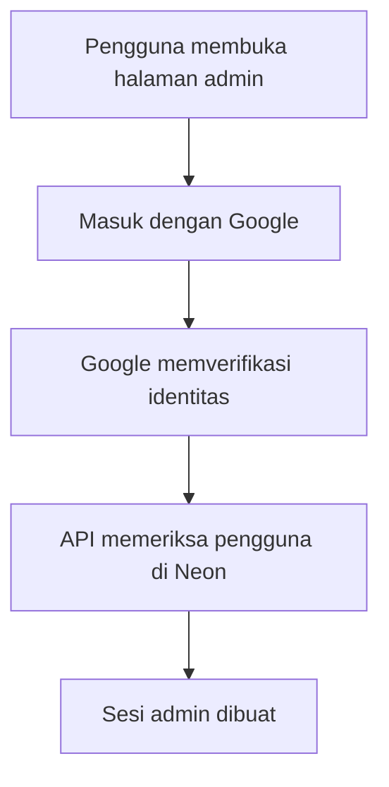

# Rancangan Integrasi Google dan Email Web Ranting Talitakumi

## 1. Identitas Dokumen

- **Nama proyek:** Web Ranting Talitakumi
- **Jenis dokumen:** Rancangan autentikasi Google dan layanan email
- **Status:** Rancangan pengembangan, belum diterapkan pada kode
- **Akun pertama:** `warahuwenag@gmail.com`
- **Peran akun pertama:** `SUPER_ADMIN`
- **Teknologi terkait:** Vue 3, Vite, Node.js, Vercel Functions, Better Auth, Neon PostgreSQL, Gmail API, dan Google OAuth 2.0/OpenID Connect

## 2. Tujuan

Rancangan ini mengatur agar setiap pengguna admin yang ditambahkan ke Web Ranting Talitakumi:

1. Harus menggunakan alamat email yang terhubung dengan akun Google.
2. Masuk melalui tombol **Masuk dengan Google**.
3. Tidak dapat mendaftarkan diri sendiri.
4. Hanya dapat masuk apabila emailnya lebih dahulu ditambahkan atau diundang oleh Super Admin.
5. Mendapatkan peran dan izin dari database aplikasi, bukan dari Google.
6. Dapat menerima undangan, pemberitahuan keamanan, dan informasi akun melalui email.

Integrasi Google hanya dipakai untuk memverifikasi identitas pengguna. Aplikasi tidak memerlukan izin untuk membaca kotak masuk, kontak, Google Drive, atau data Google lainnya.

## 3. Keputusan Utama

### 3.1 Akun pertama

`warahuwenag@gmail.com` ditetapkan sebagai:

- akun `SUPER_ADMIN` pertama;
- akun yang dibuat melalui proses bootstrap atau seed awal;
- pemilik awal pengelolaan pengguna;
- kandidat akun pengirim email sistem pada tahap awal;
- akun yang tidak boleh dihapus melalui halaman admin biasa.

Akun tersebut tetap dapat dinonaktifkan atau diganti hanya setelah terdapat Super Admin kedua yang aktif. Sistem harus mencegah penghapusan atau penurunan peran Super Admin aktif terakhir.

### 3.2 Model autentikasi

Halaman admin menggunakan **Google OAuth 2.0/OpenID Connect** melalui Better Auth. Login menggunakan email dan kata sandi lokal tidak ditampilkan untuk penggunaan normal.

Konfigurasi harus mencegah Google OAuth membuat pengguna baru secara otomatis. Pengguna baru hanya dapat diaktifkan jika emailnya sudah berada dalam daftar undangan di Neon PostgreSQL.

### 3.3 Model pengiriman email

Pengiriman email merupakan layanan terpisah dari login Google. Tahap awal dapat menggunakan Gmail API dengan `warahuwenag@gmail.com` sebagai akun pengirim.

Izin yang diminta hanya:

```text
https://www.googleapis.com/auth/gmail.send
```

Aplikasi tidak boleh meminta izin membaca, mengubah, atau menghapus email.

Untuk penggunaan produksi jangka panjang, disarankan memakai alamat organisasi khusus seperti `noreply@domain-talita-kumi.org` melalui Google Workspace. Peralihan akun pengirim tidak boleh mengubah akun login atau data pengguna.

## 4. Arsitektur



Komponen dan tanggung jawabnya:

| Komponen | Tanggung jawab |
|---|---|
| Vue 3 + Vite | Menampilkan halaman login, status undangan, dan halaman admin |
| Vercel Functions/Node.js | Memvalidasi autentikasi, izin, undangan, dan permintaan email |
| Better Auth | Mengelola Google OAuth, akun tertaut, sesi, dan cookie autentikasi |
| Neon PostgreSQL | Menyimpan pengguna, peran, status akun, undangan, sesi, dan log audit |
| Google Identity | Memverifikasi bahwa pengguna menguasai akun Google terkait |
| Gmail API | Mengirim undangan dan pemberitahuan dari akun pengirim sistem |

## 5. Perbedaan Login Google dan Gmail

| Kebutuhan | Layanan | Data/izin |
|---|---|---|
| Memastikan identitas admin | Google OAuth/OpenID Connect | `openid`, `email`, `profile` |
| Mengirim email sistem | Gmail API | `gmail.send` |
| Membaca kotak masuk | Tidak digunakan | Tidak diminta |
| Mengakses Google Drive | Tidak digunakan | Tidak diminta |
| Menentukan peran admin | Neon PostgreSQL | Data internal aplikasi |

Keberhasilan login Google tidak otomatis memberikan izin mengirim email. Sebaliknya, akun pengirim Gmail tidak otomatis menjadi pengguna admin kecuali akun tersebut tercatat sebagai pengguna aktif di Neon.

## 6. Peran Akun Pertama

Data awal yang direncanakan:

| Atribut | Nilai awal |
|---|---|
| Email | `warahuwenag@gmail.com` |
| Peran | `SUPER_ADMIN` |
| Status awal | `INVITED` atau `PENDING_GOOGLE_LINK` |
| Penyedia autentikasi | `GOOGLE` |
| Email terverifikasi | Diisi setelah login Google pertama berhasil |
| ID Google | Diisi dari klaim `sub` setelah login pertama |
| Bisa mengelola pengguna | Ya |
| Bisa mengubah peran | Ya, selain menurunkan Super Admin terakhir |
| Bisa melihat log keamanan | Ya |
| Bisa mengelola akun pengirim | Ya |

Pada login pertama, sistem mencocokkan email Google dengan `warahuwenag@gmail.com`. Jika cocok dan email dinyatakan terverifikasi oleh Google, sistem menautkan nilai `sub` Google ke akun tersebut dan mengubah status menjadi `ACTIVE`.

## 7. Alur Login

1. Pengguna membuka `/admin/login`.
2. Sistem menampilkan tombol **Masuk dengan Google**.
3. Pengguna memilih akun Google.
4. Google mengembalikan authorization code ke callback backend.
5. Backend menukar code dan memvalidasi token Google.
6. Backend memastikan:
   - token ditujukan untuk Client ID aplikasi;
   - token belum kedaluwarsa;
   - `email_verified` bernilai benar;
   - email cocok dengan pengguna yang diundang;
   - status pengguna bukan `DISABLED`, `LOCKED`, atau `DELETED`;
   - akun Google belum tertaut ke pengguna lain;
   - peran pengguna masih aktif.
7. Pada login pertama, backend menyimpan `google_sub` dan waktu penautan.
8. Backend membuat sesi database dan cookie aman.
9. Pengguna diarahkan ke dashboard sesuai izin.

Setelah akun tertaut, login berikutnya harus mencocokkan `google_sub`, bukan hanya alamat email. Email tetap digunakan sebagai informasi akun dan tujuan pemberitahuan.

## 8. Alur Penambahan Pengguna Admin

1. Super Admin membuka **Pengguna > Tambah Pengguna**.
2. Super Admin memasukkan nama, email Google, dan peran.
3. Sistem menormalisasi email menjadi huruf kecil dan menghapus spasi yang tidak diperlukan.
4. Sistem menolak email duplikat.
5. Sistem membuat pengguna berstatus `INVITED`.
6. Sistem membuat token undangan acak, menyimpan versi hash-nya, dan menentukan masa berlaku 24 jam.
7. Sistem mengirim tautan undangan melalui email.
8. Pengguna membuka tautan lalu memilih **Hubungkan dengan Google**.
9. Sistem memastikan email akun Google sama dengan email undangan.
10. Sistem mengaktifkan akun dan mencatat tindakan dalam log audit.

Pengguna yang langsung memilih **Masuk dengan Google** tanpa undangan harus ditolak, meskipun akun Google dan emailnya valid.

## 9. Status Pengguna

| Status | Penjelasan | Bisa login |
|---|---|---|
| `INVITED` | Undangan sudah dibuat, Google belum ditautkan | Hanya melalui alur undangan |
| `PENDING_GOOGLE_LINK` | Proses penautan belum selesai | Tidak |
| `ACTIVE` | Akun Google tertaut dan akun aktif | Ya |
| `DISABLED` | Dinonaktifkan Super Admin | Tidak |
| `LOCKED` | Dikunci akibat risiko keamanan | Tidak |
| `DELETED` | Dihapus secara logis dan sesi dicabut | Tidak |

## 10. Rancangan Data

### 10.1 Tabel pengguna

Kolom penting yang direncanakan:

| Kolom | Fungsi |
|---|---|
| `id` | ID internal pengguna |
| `name` | Nama pengguna |
| `email` | Email yang didaftarkan Super Admin |
| `email_normalized` | Email yang telah dinormalisasi untuk pemeriksaan unik |
| `email_verified_at` | Waktu email berhasil diverifikasi |
| `status` | Status akun |
| `role_id` | Relasi ke peran internal |
| `auth_provider` | Bernilai `GOOGLE` |
| `google_sub` | Identitas Google yang stabil dan unik |
| `google_email` | Email terakhir yang diterima dari Google |
| `google_linked_at` | Waktu penautan akun Google |
| `last_login_at` | Waktu login terakhir |
| `created_by` | Super Admin yang membuat akun |
| `created_at` | Waktu pembuatan |
| `updated_at` | Waktu perubahan terakhir |

Aturan unik wajib diterapkan pada `email_normalized` dan `google_sub`.

### 10.2 Tabel undangan

| Kolom | Fungsi |
|---|---|
| `id` | ID undangan |
| `user_id` | Pengguna yang diundang |
| `token_hash` | Hash token undangan, bukan token asli |
| `expires_at` | Waktu kedaluwarsa |
| `accepted_at` | Waktu undangan diterima |
| `revoked_at` | Waktu undangan dicabut |
| `sent_at` | Waktu email dikirim |
| `send_attempts` | Jumlah percobaan pengiriman |

### 10.3 Tabel akun pengirim email

| Kolom | Fungsi |
|---|---|
| `provider` | `GMAIL_API` |
| `sender_email` | `warahuwenag@gmail.com` pada tahap awal |
| `encrypted_refresh_token` | Token pengirim yang telah dienkripsi |
| `connected_at` | Waktu Gmail ditautkan |
| `connected_by` | Super Admin yang menghubungkan akun |
| `status` | `CONNECTED`, `EXPIRED`, atau `REVOKED` |
| `last_success_at` | Pengiriman sukses terakhir |
| `last_error_at` | Kesalahan pengiriman terakhir |

Token akses jangka pendek tidak perlu disimpan permanen. Refresh token harus dienkripsi dan tidak boleh dapat dibaca dari frontend.

## 11. Halaman Login

Isi halaman login admin:

- logo dan nama Ranting Talitakumi;
- tombol **Masuk dengan Google**;
- keterangan: “Akses hanya tersedia untuk email yang telah diundang oleh Super Admin.”;
- tautan bantuan jika pengguna merasa sudah diundang;
- pesan kegagalan yang aman dan mudah dipahami.

Contoh pesan:

| Kondisi | Pesan |
|---|---|
| Email belum terdaftar | “Email Google ini belum memiliki akses admin.” |
| Email berbeda dari undangan | “Gunakan akun Google yang sama dengan email undangan.” |
| Undangan kedaluwarsa | “Undangan sudah kedaluwarsa. Minta Super Admin mengirim ulang.” |
| Akun dinonaktifkan | “Akun tidak aktif. Hubungi Super Admin.” |
| Login dibatalkan | “Proses masuk dibatalkan. Tidak ada perubahan pada akun.” |
| Gangguan layanan | “Login belum dapat diproses. Silakan coba kembali.” |

Pesan publik tidak perlu menjelaskan apakah suatu akun tercatat secara terperinci agar sistem tidak mudah digunakan untuk enumerasi pengguna.

## 12. Halaman Pengelolaan Email

Tambahkan halaman **Pengaturan > Integrasi Email** yang hanya dapat diakses Super Admin.

Informasi yang ditampilkan:

- akun pengirim aktif;
- status koneksi Gmail;
- izin yang digunakan;
- waktu pengiriman sukses terakhir;
- waktu dan ringkasan kegagalan terakhir;
- tombol **Hubungkan Gmail**;
- tombol **Kirim Email Uji**;
- tombol **Hubungkan Ulang**;
- tombol **Putuskan Koneksi** dengan konfirmasi kuat.

Token dan rahasia OAuth tidak boleh ditampilkan pada antarmuka.

## 13. Jenis Email Sistem

| Jenis email | Penerima | Pemicu |
|---|---|---|
| Undangan pengguna | Pengguna baru | Super Admin menambah pengguna |
| Kirim ulang undangan | Pengguna berstatus `INVITED` | Super Admin memilih kirim ulang |
| Akun berhasil diaktifkan | Pengguna baru | Google berhasil ditautkan |
| Peran berubah | Pengguna terkait | Super Admin mengubah peran |
| Akun dinonaktifkan | Pengguna terkait | Super Admin menonaktifkan akun |
| Login baru berisiko | Pengguna dan/atau Super Admin | Sistem mendeteksi kondisi berisiko |
| Akun pengirim bermasalah | Super Admin | Gmail API gagal atau token dicabut |

Email tidak boleh berisi token sesi, token OAuth, rahasia aplikasi, atau data sensitif lain.

## 14. Keamanan

### 14.1 Google OAuth

- Gunakan Authorization Code Flow pada backend.
- Gunakan `state` untuk mencegah CSRF.
- Gunakan PKCE jika didukung oleh alur yang dipilih.
- Callback produksi wajib menggunakan HTTPS.
- Redirect URI harus cocok persis dengan konfigurasi Google Cloud.
- Validasi issuer, audience, expiry, nonce, `email_verified`, dan signature token.
- Gunakan `google_sub` sebagai identitas Google utama.
- Matikan pendaftaran otomatis dari social login.

### 14.2 Sesi

- Gunakan sesi yang disimpan di database agar dapat dicabut.
- Cookie harus `HttpOnly`, `Secure`, dan memakai `SameSite=Lax` atau lebih ketat sesuai kebutuhan.
- Rotasi session ID setelah login.
- Cabut seluruh sesi ketika akun dinonaktifkan, peran sensitif berubah, atau akun Google dilepas.
- Terapkan waktu tidak aktif dan waktu kedaluwarsa absolut.

### 14.3 Gmail API

- Minta hanya cakupan `gmail.send`.
- Simpan Client Secret dan kunci enkripsi sebagai environment variable rahasia di Vercel.
- Simpan refresh token dalam bentuk terenkripsi.
- Jangan meletakkan token di Vue, local storage, URL, log, atau repository.
- Catat koneksi, penggantian, dan pencabutan akun pengirim pada audit log.
- Batasi frekuensi pengiriman dan jumlah percobaan ulang.

### 14.4 Perlindungan Super Admin

- Minimal dua akun Super Admin aktif sebelum sistem digunakan penuh.
- Larang penghapusan, penurunan peran, atau penonaktifan Super Admin terakhir.
- Perubahan akun pengirim memerlukan autentikasi ulang.
- Perubahan peran sensitif harus menghasilkan pemberitahuan email dan log audit.
- Sediakan prosedur pemulihan server-side apabila konfigurasi Google bermasalah; prosedur ini bukan menu publik.

## 15. Environment Variable

Nama variabel yang direncanakan:

```env
GOOGLE_CLIENT_ID=
GOOGLE_CLIENT_SECRET=
GOOGLE_REDIRECT_URI=
BETTER_AUTH_SECRET=
BETTER_AUTH_URL=
DATABASE_URL=
EMAIL_SENDER_ADDRESS=warahuwenag@gmail.com
GMAIL_REFRESH_TOKEN_ENCRYPTION_KEY=
APP_BASE_URL=
```

Nilai rahasia tidak boleh ditulis di file dokumentasi, dikirim ke browser, atau disimpan dalam repository. Environment untuk preview dan production harus dipisahkan.

## 16. Konfigurasi Google Cloud

Rencana konfigurasi:

1. Buat atau pilih Google Cloud Project khusus Talitakumi.
2. Atur OAuth consent screen dan identitas aplikasi.
3. Buat OAuth Client untuk aplikasi web.
4. Daftarkan origin frontend yang sah.
5. Daftarkan callback Better Auth/API secara persis.
6. Aktifkan Gmail API jika fitur pengiriman menggunakan Gmail.
7. Tambahkan `warahuwenag@gmail.com` sebagai test user ketika aplikasi masih dalam mode pengujian.
8. Pisahkan OAuth Client development dan production.
9. Simpan Client Secret hanya sebagai secret Vercel.

Contoh domain yang harus disesuaikan saat implementasi:

```text
Development: http://localhost:5173
Production:  https://domain-aplikasi.vercel.app
Callback:    https://domain-aplikasi.vercel.app/api/auth/callback/google
```

Alamat callback final harus mengikuti route yang benar-benar digunakan Better Auth pada implementasi.

## 17. Audit Log

Peristiwa berikut wajib dicatat:

- login berhasil dan gagal;
- akun Google pertama kali ditautkan;
- akun Google dilepas atau berubah;
- pengguna ditambahkan atau diundang;
- undangan dikirim ulang atau dicabut;
- peran dan status pengguna berubah;
- seluruh sesi dicabut;
- akun Gmail pengirim dihubungkan atau diputus;
- email sistem berhasil atau gagal dikirim.

Log audit menyimpan ID pelaku, target, jenis tindakan, waktu, hasil, dan metadata teknis secukupnya. Token, secret, dan isi lengkap email tidak boleh masuk ke log.

## 18. Penanganan Kegagalan Email

Jika Gmail API gagal:

1. Simpan undangan tetap dalam status belum terkirim.
2. Catat kode kesalahan yang telah disanitasi.
3. Lakukan retry terbatas dengan jeda bertahap.
4. Jangan membuat token undangan baru untuk setiap retry.
5. Tampilkan status pengiriman pada halaman admin.
6. Beri notifikasi kepada Super Admin jika koneksi Gmail dicabut atau refresh token tidak valid.
7. Sediakan tombol kirim ulang setelah koneksi diperbaiki.

Kegagalan email tidak boleh mengaktifkan pengguna secara otomatis.

## 19. Pengujian Penerimaan

### 19.1 Login dan penautan

- `warahuwenag@gmail.com` dapat login pertama kali dan menjadi `SUPER_ADMIN`.
- Email Google lain yang belum diundang ditolak.
- Email undangan yang berbeda dari akun Google ditolak.
- Nilai `email_verified=false` ditolak.
- Akun `DISABLED` ditolak meskipun token Google valid.
- `google_sub` yang sudah tertaut ke pengguna lain ditolak.
- Sesi dapat dicabut dari halaman admin.

### 19.2 Pengiriman email

- Email uji dapat dikirim dari akun pengirim yang terhubung.
- Undangan hanya dikirim ke email pengguna yang dimaksud.
- Aplikasi tidak meminta izin membaca Gmail.
- Token tidak muncul di browser, respons API, atau log.
- Kegagalan Gmail menghasilkan status yang jelas dan dapat dicoba ulang.
- Pemutusan akun Gmail menghentikan pengiriman tanpa mengganggu login admin.

### 19.3 Hak akses

- Editor tidak dapat mengakses pengaturan Google atau Gmail.
- Editor tidak dapat menambah Super Admin.
- Super Admin terakhir tidak dapat dihapus atau diturunkan perannya.
- Perubahan peran mencabut atau memperbarui sesi sesuai kebijakan.

## 20. Tahapan Implementasi

### Tahap 1 — Fondasi identitas

- Menambahkan `warahuwenag@gmail.com` sebagai Super Admin awal.
- Menyiapkan tabel pengguna, peran, akun tertaut, dan sesi.
- Mengaktifkan Google OAuth pada Better Auth.
- Menonaktifkan pendaftaran otomatis.

### Tahap 2 — Undangan pengguna

- Membuat halaman tambah pengguna.
- Membuat token undangan yang aman.
- Memvalidasi kecocokan email Google dengan undangan.
- Menambahkan status dan audit log.

### Tahap 3 — Pengiriman email

- Mengaktifkan Gmail API.
- Menghubungkan akun pengirim.
- Menyimpan refresh token secara terenkripsi.
- Membuat template undangan dan email keamanan.

### Tahap 4 — Penguatan keamanan

- Membatasi percobaan login dan pengiriman.
- Menambahkan pencabutan seluruh sesi.
- Menguji CSRF, redirect URI, akses peran, dan kebocoran token.
- Menambahkan Super Admin kedua untuk pemulihan.

### Tahap 5 — Produksi

- Mengganti URL callback dengan domain produksi.
- Memisahkan secret development dan production.
- Menyelesaikan konfigurasi consent screen yang diperlukan.
- Menjalankan pengujian menyeluruh sebelum membuka akses admin.

## 21. Kriteria Selesai

Fitur dianggap selesai apabila:

1. Hanya email yang telah diundang yang dapat menjadi pengguna admin.
2. Setiap admin masuk melalui akun Google yang cocok dengan undangan.
3. `warahuwenag@gmail.com` berhasil menjadi Super Admin pertama.
4. Peran dan status selalu ditentukan dari Neon PostgreSQL.
5. Sistem tidak membuat admin baru secara otomatis melalui Google.
6. Undangan dan pemberitahuan dapat dikirim melalui akun pengirim yang terhubung.
7. Aplikasi hanya memiliki izin Gmail untuk mengirim email.
8. Seluruh secret dan token terlindungi di backend.
9. Seluruh tindakan sensitif tercatat dalam audit log.
10. Tidak ada kode proyek yang diubah hanya dengan penyusunan dokumen rancangan ini.

## 22. Ringkasan Keputusan Final

- Akun pertama: `warahuwenag@gmail.com`.
- Peran awal: `SUPER_ADMIN`.
- Metode login: Google OAuth/OpenID Connect.
- Registrasi publik: tidak tersedia.
- Aktivasi akun: melalui undangan dan kecocokan email Google.
- Sumber peran dan izin: Neon PostgreSQL.
- Pengiriman tahap awal: Gmail API menggunakan akun pengirim yang dihubungkan secara khusus.
- Izin Gmail: hanya `gmail.send`.
- Akses kotak masuk: tidak digunakan.
- Hosting dan secret: Vercel dengan environment variable terpisah.
- Status dokumen: rancangan saja, tanpa perubahan file proyek.
