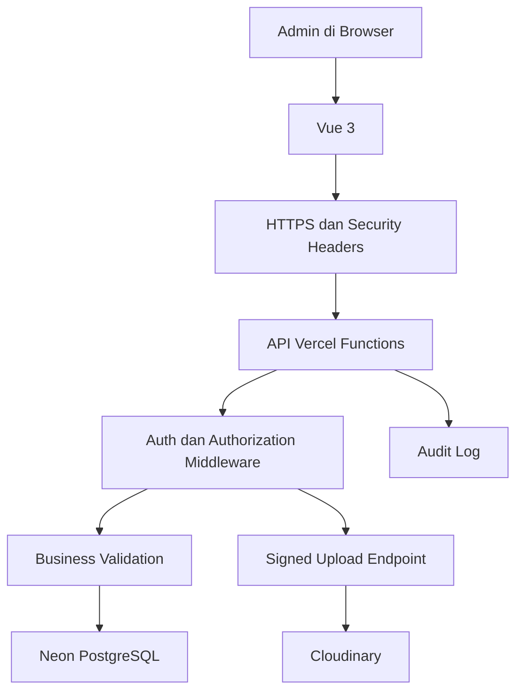
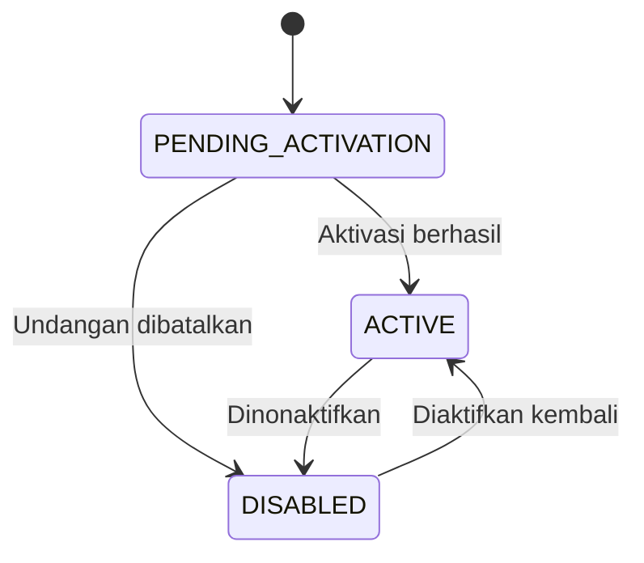

# Rancangan Pengelolaan User dan Sistem Keamanan Web Ranting Talitakumi

**Versi dokumen:** 1.0  
**Tanggal:** 5 November 2026  
**Proyek:** Web Ranting Talitakumi  
**Arsitektur:** Vue 3 + Node.js/Vercel Functions + Neon PostgreSQL + Cloudinary  
**Autentikasi yang disarankan:** Better Auth dengan sesi berbasis database  
**Status:** Rancangan keamanan dan pengelolaan akun untuk implementasi

---

## 1. Ringkasan

Dokumen ini merancang pengelolaan pengguna admin sekaligus sistem keamanan Web Ranting Talitakumi. Pengguna situs publik tidak perlu mempunyai akun. Akun hanya diberikan kepada pengurus yang berwenang mengelola konten melalui panel admin.

Sistem menggunakan dua peran awal:

1. **Super Admin**, yang mengelola akun, akses, pengaturan, dan seluruh konten.
2. **Editor**, yang mengelola konten tanpa dapat mengatur pengguna atau konfigurasi keamanan.

Tidak ada registrasi publik. Akun baru dibuat oleh Super Admin melalui undangan satu kali. Pengguna menetapkan kata sandinya sendiri melalui tautan yang mempunyai masa berlaku. Sistem menggunakan sesi berbasis database agar sesi dapat dilihat dan dicabut dari perangkat tertentu maupun seluruh perangkat.

Keamanan diterapkan berlapis pada frontend, backend, database, media, hosting, dan proses operasional. Pemeriksaan hak akses selalu dilakukan di backend. Menyembunyikan menu pada frontend hanya membantu tampilan dan tidak dianggap sebagai kontrol keamanan.

---

## 2. Hubungan dengan Dokumen Sebelumnya

Dokumen ini memperluas dan menyatukan bagian keamanan dari:

- `RANCANGAN_PENGEMBANGAN_WEB_RANTING_TALITAKUMI.md`;
- `RANCANGAN_MANAJEMEN_USER_ADMIN_TALITAKUMI.md`;
- `RANCANGAN_ANIMASI_DAN_UMPAN_BALIK_TALITAKUMI.md`.

Dokumen manajemen user sebelumnya tetap menjadi spesifikasi detail halaman. Dokumen ini menambahkan arsitektur keamanan, kebijakan teknis, operasi, respons insiden, dan checklist produksi.

---

## 3. Tujuan

Rancangan ini bertujuan untuk:

1. memastikan hanya pengguna berwenang yang dapat mengakses panel admin;
2. menerapkan hak akses berdasarkan peran;
3. mengelola pembuatan, aktivasi, perubahan, penonaktifan, dan pemulihan akun;
4. melindungi sesi, kata sandi, token, dan secret;
5. mencegah penyalahgunaan endpoint login, reset, dan upload;
6. melindungi data Neon dan aset Cloudinary;
7. mencatat tindakan penting tanpa mencatat data rahasia;
8. menyediakan pemulihan ketika akun atau secret diduga bocor;
9. memisahkan lingkungan Development, Preview, dan Production;
10. membuat keamanan cukup kuat tanpa menambah kompleksitas yang tidak diperlukan.

---

## 4. Ruang Lingkup

### 4.1 Termasuk

- akun Super Admin dan Editor;
- undangan akun;
- aktivasi dan reset kata sandi;
- login, logout, dan pengelolaan sesi;
- perubahan peran dan status akun;
- rate limiting;
- CSRF, XSS, validasi input, dan header keamanan;
- keamanan API;
- keamanan Neon PostgreSQL;
- keamanan upload Cloudinary;
- keamanan Vercel dan environment variables;
- audit log;
- backup dan pemulihan;
- respons insiden;
- pengujian keamanan;
- checklist sebelum production.

### 4.2 Tidak termasuk dalam versi pertama

- akun publik untuk anggota atau pengunjung;
- login melalui Google atau media sosial;
- permission builder yang dapat dibuat bebas oleh admin;
- impersonasi pengguna;
- single sign-on organisasi;
- perangkat keras keamanan khusus;
- Security Operations Center terpisah.

MFA disiapkan sebagai tahap lanjutan dan sangat disarankan untuk Super Admin setelah sistem dasar stabil.

---

## 5. Prinsip Keamanan

### 5.1 Least privilege

Pengguna, proses aplikasi, dan kredensial hanya mendapatkan akses yang diperlukan.

### 5.2 Deny by default

Route dan tindakan admin ditolak secara default sampai identitas dan izin berhasil diverifikasi.

### 5.3 Defense in depth

Satu kontrol tidak menjadi satu-satunya pelindung. Contohnya, upload diperiksa di browser, backend, konfigurasi Cloudinary, dan database.

### 5.4 Server is authoritative

Backend menjadi sumber keputusan untuk sesi, peran, status akun, validasi data, dan hak akses.

### 5.5 Fail securely

Jika pemeriksaan keamanan atau pencabutan sesi gagal, tindakan sensitif dibatalkan dan sistem tidak melanjutkan dengan asumsi aman.

### 5.6 Minimize sensitive data

Sistem hanya menyimpan data yang dibutuhkan. Password asli, token mentah, API secret, dan session token tidak masuk ke log.

### 5.7 Recoverability

Sistem dirancang agar akun, data, dan secret dapat dipulihkan atau dirotasi ketika terjadi kesalahan.

---

## 6. Gambaran Ancaman

| Ancaman | Contoh | Kontrol utama |
|---|---|---|
| Credential stuffing | Email dan password bocor dicoba berulang | Rate limit, pesan umum, MFA tahap lanjut |
| Brute force | Banyak tebakan password | Rate limit berlapis dan audit |
| Broken access control | Editor memanggil API Super Admin | Middleware izin dan pemeriksaan per endpoint |
| Session theft | Cookie sesi dicuri | HTTPS, HttpOnly, Secure, CSP, revocation |
| Session fixation | ID sesi lama dipakai setelah login | Regenerasi sesi setelah autentikasi/perubahan hak |
| CSRF | Situs lain memicu request dengan cookie admin | SameSite, Origin check, CSRF protection |
| XSS | Teks berbahaya disimpan atau dijalankan | Vue escaping, sanitasi, CSP, tanpa `v-html` sembarang |
| SQL injection | Input disisipkan ke query | Prisma, parameterized query, validasi |
| Malicious upload | File tidak sah diunggah | Signed upload, format/size limit, validasi metadata |
| Secret leakage | API secret masuk Git atau frontend | Vercel env, scope, rotasi, review build |
| Privilege escalation | Editor mengubah perannya sendiri | Endpoint khusus Super Admin dan audit |
| Last-admin lockout | Super Admin terakhir dinonaktifkan | Transaction dan aturan minimal satu Super Admin |
| Data loss | Kesalahan hapus atau migrasi | Soft delete, backup, PITR/branch, uji pemulihan |
| Log leakage | Token atau password tercatat | Allowlist data log dan redaction |

---

## 7. Arsitektur Keamanan



### 7.1 Batas kepercayaan

- Browser tidak dipercaya untuk menentukan role atau status akun.
- Semua input dari browser dianggap tidak terpercaya.
- Respons Cloudinary diverifikasi sebelum disimpan.
- Environment Preview tidak dipercaya membawa data Production.
- Log dianggap sensitif dan hanya dapat diakses pihak yang berwenang.

---

## 8. Jenis Pengguna dan Peran

### 8.1 Pengunjung

- tidak memiliki akun;
- hanya melihat konten `PUBLISHED`;
- tidak dapat memanggil endpoint `/api/admin/*`;
- tidak dapat meminta signature Cloudinary.

### 8.2 Editor

Editor dapat mengelola:

- beranda;
- sejarah;
- periode dan pengurus;
- bidang, program, dan kegiatan;
- album dan foto;
- profil serta sesinya sendiri.

Editor tidak dapat:

- membuka daftar pengguna;
- mengubah peran;
- menonaktifkan akun lain;
- mengubah konfigurasi keamanan;
- melihat seluruh audit log keamanan;
- mengelola secret;
- menghapus data secara permanen.

### 8.3 Super Admin

Super Admin dapat:

- melakukan seluruh tindakan Editor;
- membuat dan mengundang pengguna;
- mengubah peran;
- mengaktifkan dan menonaktifkan akun;
- membuat tautan reset;
- mencabut sesi pengguna;
- melihat audit log;
- mengubah pengaturan situs;
- menjalankan tindakan pemulihan yang tersedia di aplikasi.

Super Admin tetap tidak dapat:

- melihat password pengguna;
- melihat token sesi mentah;
- membaca secret Vercel melalui aplikasi;
- menonaktifkan Super Admin aktif terakhir;
- menurunkan perannya sendiri;
- menghapus audit log dari panel biasa.

---

## 9. Matriks Hak Akses

| Tindakan | Pengunjung | Editor | Super Admin |
|---|:---:|:---:|:---:|
| Melihat halaman publik | Ya | Ya | Ya |
| Masuk panel admin | Tidak | Ya | Ya |
| Mengelola konten | Tidak | Ya | Ya |
| Mengunggah foto | Tidak | Ya | Ya |
| Mengelola pengaturan situs | Tidak | Tidak | Ya |
| Melihat daftar user | Tidak | Tidak | Ya |
| Membuat undangan | Tidak | Tidak | Ya |
| Mengubah role | Tidak | Tidak | Ya |
| Menonaktifkan user | Tidak | Tidak | Ya |
| Mencabut sesi user lain | Tidak | Tidak | Ya |
| Melihat audit keamanan | Tidak | Tidak | Ya |
| Menghapus permanen | Tidak | Tidak | Terbatas |

---

## 10. Siklus Hidup Akun

### 10.1 Status

| Status | Arti | Login |
|---|---|:---:|
| `PENDING_ACTIVATION` | Sudah dibuat, belum membuat password | Tidak |
| `ACTIVE` | Aktif dan dapat menggunakan akses sesuai role | Ya |
| `DISABLED` | Dinonaktifkan oleh Super Admin | Tidak |

### 10.2 Alur akun



### 10.3 Penghapusan akun

- Akun yang pernah aktif tidak dihapus permanen melalui panel.
- Akun dinonaktifkan agar relasi audit tetap utuh.
- Data pribadi yang tidak lagi diperlukan dapat dianonimkan melalui prosedur khusus.
- Akun undangan yang belum pernah aktif dapat dipindahkan ke soft delete setelah dibatalkan.

---

## 11. Pembuatan Akun dan Undangan

### 11.1 Aturan

- Tidak tersedia tombol registrasi publik.
- Hanya Super Admin aktif yang dapat membuat akun.
- Email harus unik tanpa membedakan huruf besar dan kecil.
- Akun baru berstatus `PENDING_ACTIVATION`.
- Sistem membuat token acak satu kali.
- Database hanya menyimpan hash token.
- Tautan berlaku 24 jam.
- Pembuatan tautan baru mencabut tautan lama.

### 11.2 Alur

1. Super Admin mengisi nama, email, dan role.
2. Backend memvalidasi sesi Super Admin yang masih fresh.
3. Backend memeriksa email dan aturan role.
4. Akun dan invitation dibuat dalam transaction.
5. Tautan ditampilkan sekali.
6. Pengguna membuka tautan dan membuat password.
7. Token diverifikasi dan ditandai sudah digunakan.
8. Akun menjadi `ACTIVE`.
9. Session ID baru dibuat.
10. Aktivitas dicatat.

### 11.3 Tanpa layanan email pada versi awal

Tautan dapat disalin dan dikirim melalui saluran pribadi. Jika layanan email ditambahkan, token dan aturan yang sama tetap digunakan.

---

## 12. Kebijakan Password

### 12.1 Aturan pengguna

- minimal 12 karakter;
- maksimal 128 karakter atau batas pustaka;
- mendukung passphrase;
- mendukung paste dan password manager;
- tidak mewajibkan penggantian berkala tanpa indikasi kebocoran;
- tidak menggunakan pertanyaan keamanan;
- password baru tidak boleh sama dengan email;
- konfirmasi password harus cocok.

### 12.2 Penyimpanan

- Gunakan password hasher bawaan pustaka autentikasi yang teruji.
- Jangan membuat algoritma hashing sendiri.
- Jika mengonfigurasi hasher khusus, gunakan Argon2id dengan parameter yang mengikuti panduan OWASP dan disesuaikan kemampuan runtime.
- Setiap password memperoleh salt unik melalui pustaka.
- Password asli tidak pernah disimpan, dikembalikan melalui API, atau dicatat.

### 12.3 Perubahan password

- meminta password saat ini;
- memerlukan sesi yang fresh;
- setelah berhasil, cabut sesi lain;
- sediakan opsi mencabut sesi saat ini jika ada indikasi kompromi;
- catat waktu perubahan tanpa mencatat password.

---

## 13. Reset Password

### 13.1 Permintaan publik opsional

Jika tombol **Lupa Password** tersedia, respons selalu sama untuk email terdaftar maupun tidak:

```text
Jika email terdaftar, petunjuk pemulihan akan tersedia melalui mekanisme yang ditetapkan.
```

Hal ini mencegah enumerasi akun.

### 13.2 Versi awal tanpa email otomatis

- Pengguna menghubungi Super Admin melalui saluran resmi.
- Super Admin membuat tautan reset.
- Tautan dibagikan secara pribadi.
- Token berlaku 30–60 menit.
- Token hanya dapat dipakai sekali.
- Pembuatan token baru mencabut token lama.
- Setelah reset berhasil, semua sesi lama dicabut.

### 13.3 Larangan

- jangan mengirim password baru;
- jangan menyimpan token mentah;
- jangan memasukkan token ke log;
- jangan menaruh token pada query yang dikirim ke layanan pihak ketiga;
- jangan menggunakan pertanyaan keamanan.

---

## 14. Autentikasi

### 14.1 Pustaka

Gunakan Better Auth dan adapter database yang kompatibel dengan Neon/Prisma. Hindari membuat sistem autentikasi lengkap sendiri.

### 14.2 Login

1. Normalisasi email.
2. Periksa rate limit.
3. Verifikasi kredensial.
4. Periksa status `ACTIVE`.
5. Regenerasi sesi setelah login.
6. Set cookie aman.
7. Perbarui `last_login_at`.
8. Catat hasil login.

### 14.3 Pesan gagal

Gunakan pesan umum:

```text
Email atau kata sandi tidak sesuai.
```

Jangan membedakan antara email tidak ada, password salah, dan akun belum aktif pada respons publik. Informasi operasional dapat dilihat Super Admin melalui panel yang aman.

### 14.4 Reauthentication

Minta pengguna memasukkan password kembali atau MFA ketika sudah tersedia untuk:

- perubahan email;
- perubahan password;
- menjadikan pengguna Super Admin;
- menonaktifkan Super Admin lain;
- tindakan keamanan berisiko tinggi;
- melihat informasi keamanan tertentu.

---

## 15. Manajemen Sesi

### 15.1 Model

Gunakan sesi berbasis database, bukan menyimpan token autentikasi pada `localStorage`. Cookie hanya berisi session identifier yang diperlukan dan ditandatangani/dikelola oleh pustaka.

### 15.2 Cookie

Production menggunakan:

- `HttpOnly`;
- `Secure`;
- `SameSite=Lax` sebagai awal, disesuaikan jika arsitektur berubah;
- path terbatas;
- nama cookie khusus aplikasi;
- HTTPS wajib.

### 15.3 Masa berlaku

Kebijakan awal:

- idle timeout admin: 60 menit;
- absolute timeout: 7 hari;
- fresh session untuk tindakan sensitif: maksimal 10 menit sejak reauthentication;
- token undangan: 24 jam;
- token reset: 30–60 menit.

Timeout harus ditegakkan di server. Frontend hanya memberi peringatan dan tidak menjadi sumber keputusan.

### 15.4 Cookie cache Better Auth

Untuk panel admin, rekomendasi awal adalah menonaktifkan cookie cache atau memakai waktu sangat pendek. Tujuannya agar perubahan role, penonaktifan akun, dan pencabutan sesi berlaku cepat. Jika cache dipakai, operasi sensitif harus selalu memeriksa sesi langsung ke database.

### 15.5 Regenerasi dan pencabutan

Regenerasi atau buat sesi baru setelah:

- login;
- aktivasi akun;
- reset password;
- perubahan privilege.

Cabut semua sesi setelah:

- akun dinonaktifkan;
- role berubah;
- email berubah;
- reset password;
- indikasi kompromi.

Pengguna dapat melihat sesi dan mencabut sesi miliknya. Super Admin dapat mencabut sesi pengguna lain.

---

## 16. Authorization

### 16.1 Pemeriksaan berlapis

Setiap request admin melewati:

1. validasi sesi;
2. pemeriksaan akun masih `ACTIVE`;
3. pemeriksaan role;
4. pemeriksaan izin tindakan;
5. validasi kepemilikan atau target;
6. validasi aturan bisnis.

### 16.2 Middleware

- `/api/public/*`: tanpa sesi, hanya data publik.
- `/api/admin/*`: membutuhkan akun aktif.
- `/api/admin/users/*`: hanya Super Admin.
- `/api/admin/settings/*`: hanya Super Admin.
- `/api/admin/cloudinary/signature`: Editor dan Super Admin dengan scope folder yang diizinkan.
- `/api/me/*`: pengguna aktif, hanya data miliknya sendiri.

### 16.3 Object-level authorization

Backend tidak hanya memeriksa role. ID target tetap diperiksa untuk mencegah pengguna mengganti ID pada URL dan membaca/mengubah objek yang tidak diizinkan.

### 16.4 Aturan Super Admin terakhir

Perubahan role dan penonaktifan Super Admin dijalankan dalam transaction database dengan lock/pemeriksaan konsisten. Request ditolak jika hasilnya membuat jumlah Super Admin aktif menjadi nol.

---

## 17. Rate Limiting dan Anti-Abuse

### 17.1 Penyimpanan limit

Karena Vercel Functions bersifat serverless, jangan mengandalkan memory lokal function. Gunakan storage bersama yang didukung Better Auth atau tabel rate limit pada Neon.

### 17.2 Kebijakan awal

| Endpoint | Batas awal | Kunci |
|---|---:|---|
| Login | 5 percobaan/15 menit | IP + hash email |
| Aktivasi | 10 percobaan/15 menit | IP + token fingerprint |
| Reset password | 3/jam per akun, 10/jam per IP | Email hash dan IP |
| Buat undangan | 10/jam | User ID Super Admin |
| Signature Cloudinary | 20/menit | User ID |
| API tulis admin | 60/menit | User ID |

Angka dapat dikalibrasi berdasarkan pemakaian nyata. Respons `429` menyertakan waktu tunggu yang aman, misalnya melalui `Retry-After`.

### 17.3 Respons

- jangan mengunci akun permanen hanya berdasarkan IP;
- gunakan delay dan rate limit;
- catat lonjakan mencurigakan;
- tampilkan pesan jelas tanpa membocorkan keberadaan akun;
- pertimbangkan challenge/WAF jika serangan meningkat.

---

## 18. Perlindungan CSRF

Karena autentikasi memakai cookie, request yang mengubah data harus dilindungi.

Kontrol:

- gunakan perlindungan CSRF bawaan pustaka/framework jika tersedia;
- cookie `SameSite`;
- validasi `Origin` dan `Host` untuk request sensitif;
- CSRF token untuk state-changing request jika dibutuhkan arsitektur;
- hanya izinkan `POST`, `PATCH`, dan `DELETE` untuk perubahan;
- jangan mengubah data melalui `GET`;
- token tidak diletakkan di URL atau log.

XSS dapat melemahkan perlindungan CSRF, sehingga kontrol XSS tetap wajib.

---

## 19. Perlindungan XSS dan Konten

### 19.1 Aturan Vue

- gunakan interpolation Vue yang melakukan escaping;
- hindari `v-html` untuk konten dari admin;
- jika rich text wajib, sanitasi dengan allowlist di backend dan frontend;
- jangan menjalankan HTML dari database;
- validasi URL eksternal;
- tolak skema seperti `javascript:`;
- encode output sesuai konteks.

### 19.2 Content Security Policy

Mulai dengan mode `Content-Security-Policy-Report-Only`, periksa pelanggaran, lalu aktifkan enforcement.

Domain yang mungkin diperlukan:

- origin situs sendiri;
- Cloudinary untuk gambar;
- Google Fonts jika tetap digunakan;
- YouTube untuk iframe sejarah jika dipertahankan.

Hindari `unsafe-inline` dan `unsafe-eval` jika build dapat berjalan tanpanya. Gunakan nonce/hash bila script inline benar-benar diperlukan.

### 19.3 Rich text

Untuk versi pertama, gunakan field teks terstruktur atau Markdown terbatas. Ini lebih mudah diamankan daripada editor HTML bebas.

---

## 20. Validasi Input dan API

### 20.1 Validasi

- gunakan Zod atau schema server-side;
- validasi body, query, params, dan header penting;
- batasi panjang string dan jumlah item;
- normalisasi email dan slug;
- tolak field tambahan untuk endpoint sensitif;
- validasi enum role/status;
- gunakan pagination dengan batas maksimum;
- gunakan Prisma atau parameterized query.

### 20.2 Mass assignment

Jangan meneruskan seluruh body langsung ke ORM. Buat allowlist field per endpoint. Editor tidak boleh mengirim field `role`, `status`, atau `isSuperAdmin` melalui endpoint profil.

### 20.3 Error response

- tidak mengembalikan stack trace;
- tidak mengembalikan query SQL;
- tidak mengembalikan connection string;
- gunakan request ID;
- pesan validasi aman boleh dikirim;
- detail teknis hanya masuk log internal yang sudah disanitasi.

---

## 21. Header Keamanan

Header production yang direncanakan:

| Header | Kebijakan awal |
|---|---|
| `Strict-Transport-Security` | Gunakan default Vercel atau kebijakan setara setelah HTTPS stabil |
| `Content-Security-Policy` | Berdasarkan origin yang benar-benar dipakai |
| `X-Content-Type-Options` | `nosniff` |
| `Referrer-Policy` | `strict-origin-when-cross-origin` |
| `Permissions-Policy` | Nonaktifkan fitur browser yang tidak digunakan |
| `X-Frame-Options` | `DENY` atau gunakan `frame-ancestors` pada CSP |
| `Cache-Control` untuk admin sensitif | `no-store` |

Jangan mengandalkan `X-XSS-Protection` sebagai kontrol utama. CSP, encoding, dan sanitasi menjadi kontrol utama.

---

## 22. CORS dan Origin

- Frontend dan API diusahakan same-origin.
- Gunakan relative URL seperti `/api/...`.
- Jangan gunakan `Access-Control-Allow-Origin: *` untuk endpoint ber-cookie.
- Jika domain terpisah diperlukan, gunakan allowlist origin eksplisit.
- Jangan merefleksikan header Origin tanpa validasi.
- Preview dan Production mempunyai daftar origin masing-masing.

---

## 23. Keamanan Cloudinary

### 23.1 Upload

- gunakan signed upload;
- signature hanya dibuat setelah sesi dan izin diverifikasi;
- API secret tidak pernah dikirim ke browser;
- signature mempunyai timestamp dan scope parameter;
- batasi folder berdasarkan fungsi;
- batasi format: JPG, JPEG, PNG, WebP untuk galeri publik;
- batasi ukuran file;
- batasi jumlah file per batch;
- verifikasi respons Cloudinary sebelum menyimpan metadata.

### 23.2 Folder

```text
talitakumi/
├── production/
│   ├── site/
│   ├── officers/
│   └── albums/
├── preview/
└── development/
```

### 23.3 File RAW dan arsip

- `.CR2` tidak langsung ditampilkan sebagai media publik;
- konversi ke format web untuk tampilan;
- jika file RAW disimpan, gunakan `resource_type: raw` dan kebijakan akses terpisah;
- jangan mengizinkan tipe file aktif seperti HTML/SVG sembarang tanpa sanitasi dan kebutuhan jelas.

### 23.4 Penghapusan

- verifikasi aset tidak lagi digunakan;
- catat tindakan;
- hapus atau tandai database terlebih dahulu sesuai strategi transaction/compensation;
- tangani kasus Cloudinary berhasil tetapi database gagal, dan sebaliknya;
- gunakan antrean retry/pembersihan untuk aset yatim.

### 23.5 Kunci

- simpan Cloudinary secret pada Vercel Environment Variables;
- rotasi jika diduga bocor;
- batasi akses Console Cloudinary;
- gunakan MFA pada akun Cloudinary jika tersedia;
- audit upload tidak wajar dan lonjakan penggunaan.

---

## 24. Keamanan Neon PostgreSQL

### 24.1 Pemisahan kredensial

Gunakan kredensial berbeda:

- **runtime role** untuk aplikasi dengan akses tabel yang diperlukan;
- **migration role** untuk Prisma migrate dan perubahan schema;
- kredensial manusia hanya untuk admin database yang benar-benar perlu.

Runtime tidak boleh mempunyai kemampuan membuat atau menghapus database/schema tanpa kebutuhan.

### 24.2 Connection string

- `DATABASE_URL`: pooled untuk runtime Vercel;
- `DATABASE_URL_UNPOOLED`: direct untuk migrasi/CLI;
- wajib TLS;
- jangan ditaruh di frontend atau log;
- rotasi ketika anggota tim berubah atau secret bocor.

### 24.3 Lingkungan

- Production memakai branch/database Production;
- Preview memakai branch terpisah;
- Development memakai data pengujian;
- data pribadi Production tidak disalin ke Preview tanpa sanitasi;
- migration diuji pada branch sebelum Production.

### 24.4 Backup dan pemulihan

- sesuaikan retensi history dengan paket Neon;
- gunakan point-in-time recovery/branch jika tersedia;
- lakukan ekspor berkala untuk data penting jika diperlukan;
- uji pemulihan, bukan hanya menganggap backup tersedia;
- dokumentasikan RPO dan RTO sederhana.

Rekomendasi awal:

- RPO: maksimal kehilangan data 24 jam untuk backup tambahan;
- RTO: pemulihan layanan dalam beberapa jam sesuai kapasitas tim.

---

## 25. Keamanan Vercel

### 25.1 Environment Variables

- pisahkan Development, Preview, dan Production;
- hanya variabel `VITE_*` yang boleh masuk bundle frontend;
- jangan memberi prefix `VITE_` pada database URL, auth secret, atau Cloudinary API secret;
- perubahan environment variable memerlukan deployment baru;
- hapus secret yang tidak dipakai;
- rotasi secret secara berkala atau saat insiden.

### 25.2 Preview Deployment

- aktifkan Vercel Deployment Protection untuk Preview;
- jangan gunakan data Production pada Preview;
- lindungi build logs dan source;
- gunakan relative API paths agar autentikasi deployment tetap bekerja;
- nonaktifkan indexing melalui `robots.txt`/header yang sesuai pada Preview.

### 25.3 Akses proyek

- akses dashboard Vercel hanya untuk anggota yang perlu;
- gunakan role tim paling rendah yang mencukupi;
- aktifkan MFA pada akun Vercel;
- cabut akses anggota yang sudah tidak terlibat;
- tinjau integrasi Git dan deployment hooks.

### 25.4 WAF dan challenge

Gunakan fitur firewall/challenge Vercel jika tersedia pada paket dan dibutuhkan setelah melihat pola trafik. Rate limit aplikasi tetap diperlukan untuk endpoint autentikasi.

---

## 26. Secret Management dan Rotasi

### 26.1 Secret

Secret utama:

- `BETTER_AUTH_SECRET` atau `AUTH_SECRET`;
- `DATABASE_URL`;
- `DATABASE_URL_UNPOOLED`;
- `CLOUDINARY_API_SECRET`;
- token layanan email jika ditambahkan;
- webhook secret jika ditambahkan.

### 26.2 Aturan

- tidak masuk Git;
- tidak ditulis di dokumentasi publik;
- tidak dicetak ke log;
- tidak dikirim melalui chat biasa;
- hanya tersedia pada lingkungan yang membutuhkan;
- gunakan panjang dan entropi yang direkomendasikan penyedia;
- simpan pemilik, tanggal dibuat, dan tanggal rotasi di catatan aman tanpa menyimpan nilainya.

### 26.3 Rotasi

Prosedur:

1. buat secret baru;
2. tambahkan tanpa langsung menghapus secret lama jika pustaka mendukung rotasi bertahap;
3. deploy;
4. verifikasi autentikasi dan layanan;
5. cabut secret lama;
6. deploy ulang bila diperlukan;
7. catat perubahan.

Better Auth mendukung pendekatan versioned secret pada versi yang sesuai. Implementasi harus mengikuti dokumentasi versi yang dipasang.

---

## 27. Audit Log

### 27.1 Tindakan yang dicatat

- login berhasil dan gagal;
- logout;
- rate limit terlampaui;
- akun dibuat dan diaktifkan;
- undangan dibuat/dicabut;
- reset password dibuat dan diselesaikan;
- role berubah;
- akun aktif/nonaktif;
- sesi dicabut;
- akses ditolak;
- perubahan pengaturan;
- upload dan penghapusan media penting;
- penghapusan dan pemulihan data.

### 27.2 Data log

- waktu;
- actor user ID;
- action;
- target type dan ID;
- hasil;
- request ID;
- IP yang dipotong atau di-hash;
- user agent yang dibatasi;
- metadata allowlist.

### 27.3 Dilarang masuk log

- password;
- token aktivasi/reset mentah;
- session token;
- cookie;
- database connection string;
- auth secret;
- Cloudinary secret;
- body request penuh tanpa filter.

### 27.4 Retensi

Rekomendasi awal: 12 bulan untuk audit tindakan admin, kemudian arsip atau hapus sesuai kebutuhan. Login gagal berulang dapat disimpan lebih singkat jika tidak diperlukan lagi.

Audit log tidak dapat diubah atau dihapus melalui halaman admin biasa.

---

## 28. Tampilan Keamanan pada Panel Admin

### 28.1 Halaman Pengguna

- daftar nama, email, role, status, login terakhir;
- filter role/status;
- tambah user;
- detail dan aktivitas;
- pengelolaan sesi;
- aktif/nonaktif;
- perubahan role dengan alasan.

### 28.2 Halaman Keamanan

**Route:** `/admin/keamanan`

Khusus Super Admin, berisi:

- jumlah user aktif;
- jumlah sesi aktif;
- login gagal 24 jam terakhir;
- akun menunggu aktivasi;
- undangan/reset kedaluwarsa;
- event keamanan terbaru;
- status backup/pemulihan terakhir secara administratif;
- tombol menuju audit log.

Halaman tidak menampilkan secret atau connection string.

### 28.3 Halaman Sesi Saya

- perangkat/browser;
- waktu login;
- aktivitas terakhir;
- sesi saat ini;
- cabut sesi;
- cabut semua sesi lain.

### 28.4 Feedback

Pesan dan animasi mengikuti `RANCANGAN_ANIMASI_DAN_UMPAN_BALIK_TALITAKUMI.md`.

---

## 29. Struktur Database Keamanan

### 29.1 Tabel utama

- `users`;
- `sessions`;
- `admin_invitations`;
- `password_reset_tokens`;
- `activity_logs`;
- `rate_limits` jika memakai database storage;
- `security_events` opsional jika dipisah dari audit umum.

### 29.2 Field penting `users`

| Field | Keterangan |
|---|---|
| `id` | UUID |
| `name` | Nama |
| `email` | Unik dan ternormalisasi |
| `role` | `SUPER_ADMIN` atau `EDITOR` |
| `status` | Pending, Active, Disabled |
| `email_verified_at` | Aktivasi/verifikasi |
| `last_login_at` | Login terakhir |
| `password_changed_at` | Perubahan terakhir |
| `disabled_at` | Waktu dinonaktifkan |
| `disabled_by_id` | Pelaku |
| `disabled_reason` | Alasan |
| `created_at`, `updated_at` | Audit waktu |

### 29.3 Token

Tabel invitation dan reset hanya menyimpan `token_hash`, waktu kedaluwarsa, penggunaan, pencabutan, dan pembuat. Token asli hanya tersedia pada tautan ketika dibuat.

### 29.4 Transaction

Gunakan transaction untuk:

- akun + invitation;
- aktivasi + token used + password;
- reset password + revoke sessions;
- perubahan role + revoke sessions;
- disable user + revoke sessions;
- pemeriksaan Super Admin terakhir.

---

## 30. Endpoint dan Kebijakan Akses

| Endpoint | Akses | Kontrol tambahan |
|---|---|---|
| `POST /api/auth/sign-in` | Publik | Rate limit, pesan umum |
| `POST /api/auth/activate` | Publik bertoken | Token sekali pakai, expiry |
| `POST /api/auth/reset-password` | Publik bertoken | Rate limit, revoke session |
| `GET /api/me` | User aktif | Session check |
| `GET /api/me/sessions` | User aktif | Hanya sesi sendiri |
| `DELETE /api/me/sessions/:id` | User aktif | Object ownership |
| `GET /api/admin/users` | Super Admin | Audit |
| `POST /api/admin/users` | Super Admin | Fresh session, rate limit |
| `PATCH /api/admin/users/:id/role` | Super Admin | Reauth, transaction, reason |
| `POST /api/admin/users/:id/disable` | Super Admin | Reauth, transaction, reason |
| `DELETE /api/admin/users/:id/sessions` | Super Admin | Audit |
| `POST /api/admin/cloudinary/signature` | Editor/Super Admin | Scope, format, rate limit |

---

## 31. Caching dan Data Sensitif

- respons profil, sesi, pengguna, dan audit memakai `Cache-Control: no-store`;
- jangan cache API admin di CDN publik;
- jangan memasukkan data sesi ke HTML statis;
- logout dapat memakai `Clear-Site-Data` secara hati-hati sesuai kebutuhan;
- jangan menyimpan token auth di localStorage/sessionStorage;
- draft lokal tidak boleh memuat secret;
- data publik dapat di-cache terpisah dari admin.

---

## 32. Dependency dan Supply Chain

- gunakan lockfile dan commit ke Git;
- pin major version untuk Prisma dan adapter;
- perbarui dependency secara terjadwal;
- periksa changelog sebelum update besar;
- jalankan audit dependency pada CI;
- gunakan package dari sumber resmi;
- minimalkan dependency;
- tinjau postinstall script yang tidak dikenal;
- lindungi branch utama dan review perubahan workflow/deployment;
- jangan menjalankan kode dari input pengguna.

---

## 33. Backup dan Pemulihan

### 33.1 Data database

- gunakan Neon history/PITR sesuai paket;
- buat prosedur ekspor berkala;
- enkripsi backup;
- batasi akses backup;
- uji restore pada branch terpisah;
- dokumentasikan hasil uji.

### 33.2 Media

- simpan `public_id` Cloudinary pada database;
- ekspor inventaris aset berkala;
- hindari penghapusan permanen langsung;
- dokumentasikan rekonsiliasi aset yatim;
- pertimbangkan backup media jika nilai dokumentasi tinggi.

### 33.3 Konfigurasi

- simpan `.env.example` tanpa nilai;
- dokumentasikan nama environment variables;
- simpan konfigurasi nonsecret dalam Git;
- simpan daftar layanan, pemilik, dan prosedur pemulihan di tempat aman.

---

## 34. Respons Insiden

### 34.1 Akun diduga diambil alih

1. Nonaktifkan akun.
2. Cabut semua sesi.
3. Buat reset password.
4. Tinjau audit log.
5. Periksa perubahan konten, user, dan media.
6. Pulihkan perubahan yang tidak sah.
7. Aktifkan kembali setelah verifikasi.
8. Catat insiden.

### 34.2 Auth secret bocor

1. Anggap seluruh sesi berisiko.
2. Rotasi auth secret dengan mekanisme versioned jika tersedia.
3. Cabut sesi jika tingkat risiko mengharuskan.
4. Deploy ulang.
5. Periksa log akses dan source leak.
6. Hapus secret lama.

### 34.3 Database URL bocor

1. Rotasi password/role database.
2. Perbarui Vercel env.
3. Deploy ulang.
4. Cabut kredensial lama.
5. Periksa query dan perubahan mencurigakan.
6. Restore jika integritas terganggu.

### 34.4 Cloudinary secret bocor

1. Rotasi API secret/key sesuai kemampuan penyedia.
2. Perbarui Vercel env.
3. Deploy ulang.
4. Audit upload, transformasi, dan penghapusan.
5. Bersihkan aset tidak sah.

### 34.5 Upload berbahaya atau spam

1. Nonaktifkan signature endpoint jika perlu.
2. Cabut sesi akun pelaku.
3. Hapus atau karantina aset.
4. Audit penggunaan Cloudinary.
5. Perketat format, ukuran, rate limit, dan WAF.

---

## 35. Monitoring

Pantau:

- lonjakan login gagal;
- banyak reset password;
- rate limit terlampaui;
- perubahan role;
- penonaktifan akun;
- pembuatan banyak signature upload;
- lonjakan upload/traffic Cloudinary;
- error database;
- respons `401`, `403`, `429`, dan `500`;
- perubahan environment dan deployment;
- backup/restore yang gagal.

Alert awal dapat berupa pemeriksaan dashboard dan log rutin. Notifikasi otomatis ditambahkan jika penggunaan meningkat.

---

## 36. Privasi dan Retensi

- hanya simpan data pengguna admin yang diperlukan;
- tampilkan IP secara dipotong atau hash pada UI;
- jangan menyimpan lokasi presisi;
- batasi akses audit log;
- tentukan retensi log;
- anonimisasi akun lama jika diperlukan;
- jangan memakai data Production untuk demo;
- dokumentasikan siapa yang dapat mengakses Vercel, Neon, dan Cloudinary.

---

## 37. Pengujian Keamanan

### 37.1 Unit test

- normalisasi dan uniqueness email;
- aturan role/status;
- Super Admin terakhir;
- token expiry dan one-time use;
- session freshness;
- sanitasi audit log;
- allowlist field;
- pemetaan error aman.

### 37.2 Integration test

- Editor ditolak pada setiap endpoint Super Admin;
- mengganti ID target tidak melewati authorization;
- akun disabled ditolak walau session cookie masih ada;
- role change mencabut sesi;
- reset password mencabut sesi;
- token lama gagal setelah token baru dibuat;
- CSRF/Origin invalid ditolak;
- rate limit konsisten di beberapa function instance;
- upload signature dibatasi scope;
- mass assignment field role ditolak.

### 37.3 End-to-end test

- undangan sampai aktivasi;
- login/logout;
- reset password;
- perubahan role;
- disable/enable;
- session list/revoke;
- akses langsung route terlarang;
- upload valid/invalid;
- sesi berakhir;
- recovery setelah error.

### 37.4 Pengujian manual

- cookie attributes;
- security headers;
- CSP Report-Only lalu enforcement;
- tidak ada secret pada bundle frontend;
- tidak ada secret pada source map/log;
- Preview tidak memakai Production DB;
- backup dapat dipulihkan;
- logout menonaktifkan sesi;
- browser back tidak menampilkan data admin dari cache.

---

## 38. Checklist Sebelum Production

### Akun

- [ ] Super Admin pertama aktif.
- [ ] Minimal satu akun pemulihan administratif yang sah tersedia sesuai kebijakan.
- [ ] Tidak ada akun uji aktif.
- [ ] Tidak ada registrasi publik.
- [ ] MFA akun layanan Vercel, Neon, Cloudinary aktif jika tersedia.

### Autentikasi

- [ ] Cookie `HttpOnly`, `Secure`, dan `SameSite` benar.
- [ ] Session revocation berhasil.
- [ ] Rate limit aktif pada production.
- [ ] Reset dan invitation token sekali pakai.
- [ ] Pesan login tidak mengungkap keberadaan akun.

### Authorization

- [ ] Semua endpoint admin mempunyai middleware.
- [ ] Editor ditolak oleh backend pada endpoint Super Admin.
- [ ] Object-level authorization diuji.
- [ ] Super Admin terakhir terlindungi dalam transaction.

### Vercel

- [ ] Environment variables dipisahkan per lingkungan.
- [ ] Tidak ada secret berawalan `VITE_`.
- [ ] Preview Deployment dilindungi.
- [ ] Build log dan source terlindungi.
- [ ] Security headers aktif.

### Neon

- [ ] Runtime memakai pooled connection.
- [ ] Migration memakai direct connection.
- [ ] Runtime role dibatasi.
- [ ] Preview memakai branch terpisah.
- [ ] Restore pernah diuji.

### Cloudinary

- [ ] Upload menggunakan signature.
- [ ] API secret hanya berada di server.
- [ ] Format, ukuran, folder, dan jumlah dibatasi.
- [ ] Rekonsiliasi aset yatim tersedia.
- [ ] Akses console dibatasi.

### Aplikasi

- [ ] CSP diuji.
- [ ] Validasi server aktif.
- [ ] CORS tidak wildcard untuk cookie.
- [ ] API admin tidak di-cache publik.
- [ ] Audit log tidak memuat secret.
- [ ] Dependency audit selesai.

---

## 39. Tahapan Implementasi

### Tahap 1 — Fondasi keamanan

- pilih dan kunci versi Better Auth;
- buat tabel auth dan audit;
- konfigurasi secret;
- buat Super Admin pertama;
- implementasi login/logout/session.

### Tahap 2 — User management

- daftar/detail user;
- invitation;
- aktivasi;
- role/status;
- reset password;
- session management.

### Tahap 3 — Authorization

- middleware;
- policy per endpoint;
- object-level check;
- last Super Admin transaction;
- reauthentication.

### Tahap 4 — Proteksi API

- Zod schema;
- rate limiting bersama;
- CSRF/Origin protection;
- error redaction;
- no-store response.

### Tahap 5 — Infrastruktur

- Vercel environment separation;
- Neon roles/branches;
- Cloudinary signed upload;
- deployment protection;
- security headers dan CSP Report-Only.

### Tahap 6 — Audit dan recovery

- audit/security event;
- backup/restore test;
- secret rotation procedure;
- incident response;
- monitoring.

### Tahap 7 — Verifikasi produksi

- pengujian unit/integration/E2E;
- security checklist;
- CSP enforcement;
- dokumentasi operasional;
- serah terima akses.

---

## 40. Kriteria Penerimaan

Sistem dianggap siap ketika:

1. tidak ada registrasi publik;
2. hanya akun aktif yang dapat login;
3. password tidak pernah disimpan dalam bentuk asli;
4. sesi memakai cookie aman dan berbasis server/database;
5. token auth tidak disimpan pada localStorage;
6. sesi dapat dilihat dan dicabut;
7. perubahan role/disable/reset mencabut sesi yang semestinya;
8. Editor ditolak oleh backend pada endpoint Super Admin;
9. sistem mempertahankan minimal satu Super Admin aktif;
10. invitation dan reset token berlaku sekali serta kedaluwarsa;
11. login dan endpoint sensitif memiliki rate limit shared;
12. CSRF dan Origin protection aktif;
13. input divalidasi di server;
14. error tidak membocorkan stack trace atau secret;
15. CSP dan security headers dikonfigurasi;
16. upload Cloudinary memakai signed upload;
17. Cloudinary secret tidak masuk frontend;
18. runtime database memakai role terbatas dan koneksi pooled;
19. Preview terpisah dan terlindungi;
20. audit log mencatat tindakan penting tanpa token/password;
21. secret dapat dirotasi dengan prosedur yang terdokumentasi;
22. backup database pernah diuji pemulihannya;
23. respons insiden untuk akun, database, auth, dan media tersedia;
24. dependency dan workflow deployment sudah diperiksa;
25. seluruh pengujian keamanan wajib lulus.

---

## 41. Keputusan yang Dikunci

- Hanya ada Super Admin dan Editor pada versi pertama.
- Tidak ada registrasi publik.
- Akun dibuat melalui invitation satu kali.
- Better Auth digunakan sebagai dasar autentikasi.
- Sesi disimpan di database dan dapat dicabut.
- Cookie cache dinonaktifkan atau dibuat sangat singkat untuk panel admin.
- Authorization selalu diperiksa di backend.
- Password minimal 12 karakter dan mendukung password manager.
- Tidak ada pergantian password berkala tanpa alasan keamanan.
- Rate limit memakai shared storage, bukan memory function.
- Upload Cloudinary wajib signed.
- Environment Development, Preview, dan Production dipisahkan.
- Audit log wajib dan tidak dapat dihapus melalui panel biasa.
- Super Admin terakhir tidak dapat dinonaktifkan atau diturunkan perannya.
- MFA menjadi prioritas tahap berikutnya untuk Super Admin.

---

## 42. Referensi Resmi

- OWASP Authentication Cheat Sheet: <https://cheatsheetseries.owasp.org/cheatsheets/Authentication_Cheat_Sheet.html>
- OWASP Authorization Cheat Sheet: <https://cheatsheetseries.owasp.org/cheatsheets/Authorization_Cheat_Sheet.html>
- OWASP Password Storage Cheat Sheet: <https://cheatsheetseries.owasp.org/cheatsheets/Password_Storage_Cheat_Sheet.html>
- OWASP Session Management Cheat Sheet: <https://cheatsheetseries.owasp.org/cheatsheets/Session_Management_Cheat_Sheet.html>
- OWASP CSRF Prevention Cheat Sheet: <https://cheatsheetseries.owasp.org/cheatsheets/Cross-Site_Request_Forgery_Prevention_Cheat_Sheet.html>
- OWASP Logging Cheat Sheet: <https://cheatsheetseries.owasp.org/cheatsheets/Logging_Cheat_Sheet.html>
- Better Auth Security: <https://better-auth.com/docs/reference/security>
- Better Auth Session Management: <https://better-auth.com/docs/concepts/session-management>
- Better Auth Rate Limit: <https://better-auth.com/docs/concepts/rate-limit>
- Vercel Environment Variables: <https://vercel.com/docs/environment-variables>
- Vercel Deployment Protection: <https://vercel.com/docs/deployment-protection>
- Vercel Production Checklist: <https://vercel.com/docs/production-checklist>
- Neon Security: <https://neon.com/security>
- Cloudinary Upload Security: <https://cloudinary.com/documentation/upload_images>
- Cloudinary Authentication Signatures: <https://cloudinary.com/documentation/authentication_signatures>

---

## 43. Kesimpulan

Pengelolaan user Talitakumi menggunakan akun tertutup dengan dua role, invitation satu kali, password yang dibuat sendiri oleh pengguna, serta sesi berbasis database yang dapat dicabut. Sistem melindungi Super Admin terakhir, menolak akses berdasarkan policy backend, dan mencatat tindakan keamanan penting.

Keamanan aplikasi tidak hanya berada pada halaman login. Kontrol diterapkan pada API, database Neon, upload Cloudinary, Vercel, secret, backup, logging, dan prosedur operasional. Dengan rancangan ini, sistem tetap praktis untuk dikelola oleh organisasi kecil namun mempunyai fondasi yang cukup kuat untuk digunakan secara resmi dan dikembangkan lebih lanjut.
